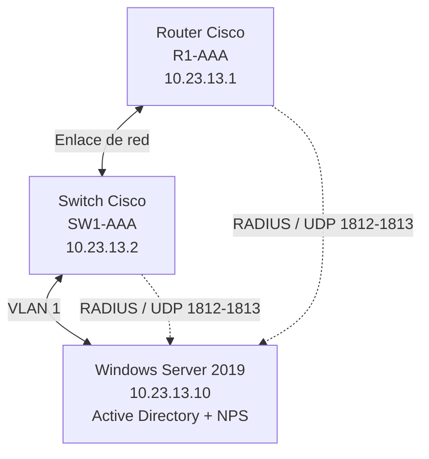
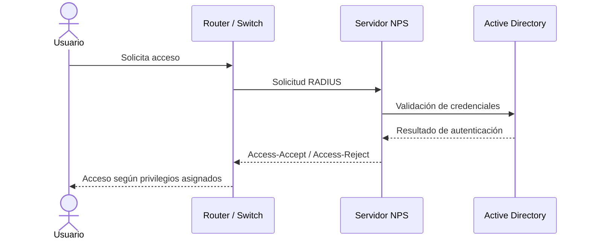

# Tarea-Semana-6-Asignaci-n-2-
# Laboratorio de Autenticación, Autorización y Auditoría (AAA) con RADIUS

<p align="center">
  
  
  
  
</p>

## 🎥 Video demostrativo

**Enlace al video:** [AGREGAR AQUÍ EL ENLACE DEL VIDEO]

> El video presenta la infraestructura implementada, la configuración de autenticación y autorización AAA, la integración con RADIUS y las pruebas de acceso realizadas en el router y el switch.

---

## 📌 1. Propósito del laboratorio

El propósito de este laboratorio es implementar una infraestructura de autenticación, autorización y auditoría (AAA) para administrar de manera centralizada el acceso a dispositivos de red Cisco mediante el protocolo RADIUS.

Se busca garantizar que los usuarios sean autenticados antes de obtener acceso a los dispositivos, que reciban los niveles de privilegio correspondientes y que las actividades de administración puedan ser supervisadas mediante registros de eventos.

La implementación permite comprobar el funcionamiento de diferentes niveles de privilegio (0, 5 y 10), utilizar cuentas locales como mecanismo alternativo de acceso y administrar los dispositivos mediante SSH.

## 🎯 2. Objetivos

- Implementar autenticación, autorización y contabilidad mediante AAA.
- Integrar dispositivos Cisco con un servidor RADIUS.
- Configurar el router y el switch como clientes RADIUS.
- Implementar diferentes niveles de privilegio para los usuarios.
- Crear cuentas locales para acceso alternativo.
- Habilitar registros de autenticación, autorización y RADIUS.
- Configurar el servicio SSH para la administración remota.
- Validar el funcionamiento de la infraestructura mediante pruebas.

## 🏗️ 3. Infraestructura utilizada

| Dispositivo | Nombre | Dirección IP |
|---|---|---|
| Router Cisco | R1-AAA | 10.23.13.1 |
| Switch Cisco | SW1-AAA | 10.23.13.2 |
| Windows Server 2019 | SERVIDOR-AAA | 10.23.13.10 |

**Red utilizada:** `10.23.13.0/24`

**Dominio:** `aaa20231323.local`

**Herramienta de simulación:** GNS3.

## 🌐 4. Diagrama de topología



La topología está compuesta por un router, un switch y un servidor Windows Server 2019 conectados dentro de la red `10.23.13.0/24`.

El router y el switch utilizan el servidor RADIUS para validar las solicitudes de autenticación y recibir las respuestas de autorización.

## 🔐 5. Niveles de privilegio

Se implementaron tres niveles de privilegio para controlar las operaciones que pueden realizar los usuarios dentro de los dispositivos Cisco.

| Nivel | Grupo de Active Directory | Usuario de prueba |
|---|---|---|
| 0 | GG_CISCO_PRIV_0 | cisco_nivel0 |
| 5 | GG_CISCO_PRIV_5 | cisco_nivel5 |
| 10 | GG_CISCO_PRIV_10 | cisco_nivel10 |

Cada grupo tiene asociado un nivel de privilegio mediante los atributos específicos de Cisco enviados por RADIUS.

**Atributo utilizado:**

`Cisco-AVPair = shell:priv-lvl=X`

Donde `X` representa el nivel de privilegio asignado al usuario.

## ⚙️ 6. Funcionamiento de la autenticación AAA

El proceso de autenticación y autorización funciona de la siguiente manera:



1. El usuario intenta ingresar al router o switch.
2. El dispositivo envía la solicitud de autenticación al servidor RADIUS.
3. NPS procesa la solicitud y valida las credenciales mediante Active Directory.
4. El servidor determina la política correspondiente al grupo del usuario.
5. NPS devuelve la respuesta de autenticación y autorización.
6. El dispositivo permite o rechaza el acceso según el resultado recibido.

## 🖥️ 7. Configuración del router

**Dispositivo:** R1-AAA  
**Dirección IP:** `10.23.13.1`

### 7.1. Configuración AAA

Se habilita el modelo AAA para administrar los mecanismos de autenticación, autorización y contabilidad.

Comando de verificación:

```cisco
show running-config | section aaa
```

### 7.2. Configuración del cliente RADIUS

Se configura la dirección del servidor RADIUS y los puertos utilizados para autenticación y contabilidad.

```cisco
show running-config | section radius
show aaa servers
```

### 7.3. Usuario local

Se crea un usuario local para disponer de un mecanismo alternativo de administración.

```cisco
show running-config | include username
```

### 7.4. Consola y puerto auxiliar

Se configuran los mecanismos AAA correspondientes a los accesos físicos de administración.

```cisco
show running-config | section line con
show running-config | section line aux
```

### 7.5. Registros y estadísticas

Se habilitan y consultan los registros relacionados con la autenticación, autorización y comunicación RADIUS.

```cisco
show logging
show radius statistics
```

### 7.6. Servicio SSH

Se habilita SSH para permitir la administración remota cifrada del dispositivo.

```cisco
show ip ssh
show running-config | section line vty
```

## 🔀 8. Configuración del switch

**Dispositivo:** SW1-AAA  
**Dirección IP:** `10.23.13.2`

### 8.1. Configuración AAA

Se habilita AAA para controlar el acceso administrativo y los privilegios de los usuarios.

```cisco
show running-config | section aaa
```

### 8.2. Configuración del cliente RADIUS

Se configura el switch como cliente RADIUS, estableciendo la comunicación con el servidor NPS.

```cisco
show running-config | section radius
show aaa servers
```

### 8.3. Usuario local

Se crea una cuenta local para disponer de acceso alternativo al dispositivo.

```cisco
show running-config | include username
```

### 8.4. Consola y puerto auxiliar

Se verifican los mecanismos de autenticación y autorización configurados en los accesos físicos.

```cisco
show running-config | section line con
show running-config | section line aux
```

### 8.5. Registros y estadísticas

Se consultan los registros del dispositivo y las estadísticas de comunicación RADIUS.

```cisco
show logging
show radius statistics
```

### 8.6. Servicio SSH

Se verifica que SSH esté habilitado y que las líneas VTY estén configuradas para la administración remota.

```cisco
show ip ssh
show running-config | section line vty
```

## 🧪 9. Pruebas y validación

Se realizaron pruebas de autenticación utilizando los usuarios correspondientes a los niveles 0, 5 y 10.

Para comprobar el nivel de privilegio asignado durante cada sesión se utilizó:

```cisco
show privilege
```

También se verificó el estado de los servidores AAA y RADIUS mediante:

```cisco
show aaa servers
show radius statistics
```

### Evidencias del laboratorio

| Prueba | Evidencia |
|---|---|
| Autenticación del usuario nivel 0 | AGREGAR CAPTURA |
| Autenticación del usuario nivel 5 | AGREGAR CAPTURA |
| Autenticación del usuario nivel 10 | AGREGAR CAPTURA |
| Validación de privilegios en router | AGREGAR CAPTURA |
| Validación de privilegios en switch | AGREGAR CAPTURA |
| Comunicación con RADIUS | AGREGAR CAPTURA |
| Acceso mediante SSH | AGREGAR CAPTURA |

## 📋 10. Resultados obtenidos

Como resultado de la implementación se consiguió:

- Establecer comunicación entre los dispositivos Cisco y el servidor RADIUS.
- Validar las credenciales de los usuarios mediante autenticación centralizada.
- Aplicar diferentes niveles de privilegio a los usuarios.
- Comprobar los niveles de privilegio asignados desde las sesiones de administración.
- Configurar usuarios locales como alternativa de acceso.
- Habilitar mecanismos de registro y supervisión.
- Realizar pruebas de administración remota mediante SSH.

## 📚 11. Conclusión

La implementación permitió comprender y poner en práctica el funcionamiento de AAA y RADIUS dentro de una infraestructura de red.

Mediante la integración de los dispositivos Cisco con Windows Server 2019, se estableció un mecanismo centralizado para validar las credenciales de los usuarios y controlar sus privilegios.

Las pruebas realizadas permitieron verificar la autenticación de los usuarios y la asignación de los niveles de privilegio 0, 5 y 10, demostrando la importancia de implementar controles de acceso y mecanismos de auditoría en la administración de infraestructuras de red.

## 👨‍💻 12. Autor

**Proyecto académico:** Laboratorio AAA con RADIUS  
**Institución:** Instituto Tecnológico de las Américas (ITLA)  
**Área:** Seguridad de Redes  
**Autor:** Amaurys Daniel De La Cruz Duval

---

<p align="center">
  <b>Laboratorio de Seguridad de Redes — AAA / RADIUS</b><br>
  Instituto Tecnológico de las Américas (ITLA)
</p>
