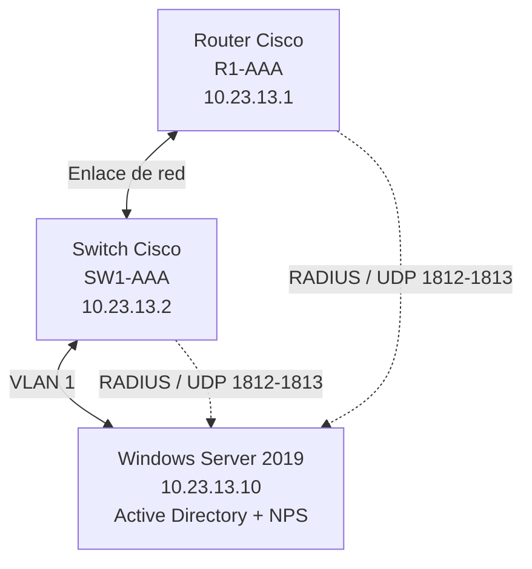
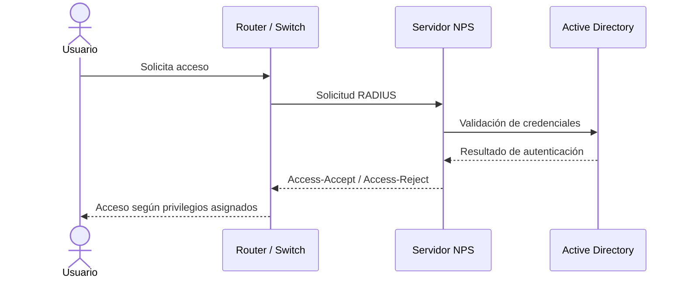

# Tarea-Semana-6-Asignaci-n-2-
# Laboratorio de Autenticación, Autorización y Auditoría (AAA) con RADIUS

  
  
  
  

## 🎥 Video demostrativo

**Enlace al video:**

> El video presenta la infraestructura implementada, la configuración de autenticación y autorización AAA, la integración con RADIUS y las pruebas de acceso realizadas en el router y el switch.

---

## 📌 1. Propósito del laboratorio

El propósito de este laboratorio es implementar una infraestructura de autenticación, autorización y auditoría (AAA) para administrar de manera centralizada el acceso a dispositivos de red Cisco mediante el protocolo RADIUS.

Se busca garantizar que los usuarios sean autenticados antes de obtener acceso a los dispositivos, que reciban los niveles de privilegio correspondientes y que las actividades de administración puedan ser supervisadas mediante registros de eventos.

La implementación permite comprobar el funcionamiento de diferentes niveles de privilegio (0, 5 y 10), utilizar cuentas locales como mecanismo alternativo de acceso y administrar los dispositivos mediante SSH.

## 🎯 2. Objetivos

- Implementar autenticación, autorización y contabilidad mediante AAA.
- Integrar dispositivos Cisco con un servidor RADIUS.
- Configurar el router y el switch como clientes RADIUS.
- Implementar diferentes niveles de privilegio para los usuarios.
- Crear cuentas locales para acceso alternativo.
- Habilitar registros de autenticación, autorización y RADIUS.
- Configurar el servicio SSH para la administración remota.
- Validar el funcionamiento de la infraestructura mediante pruebas.

## 🏗️ 3. Infraestructura utilizada

| Dispositivo | Nombre | Dirección IP |
|---|---|---|
| Router Cisco | R1-AAA | 10.23.13.1 |
| Switch Cisco | SW1-AAA | 10.23.13.2 |
| Windows Server 2019 | SERVIDOR-AAA | 10.23.13.10 |

**Red utilizada:** `10.23.13.0/24`

**Dominio:** `aaa20231323.local`

**Herramienta de simulación:** GNS3.

## 🌐 4. Diagrama de topología

La topología está compuesta por un router, un switch y un servidor Windows Server 2019 conectados dentro de la red `10.23.13.0/24`.

El router y el switch utilizan el servidor RADIUS para validar las solicitudes de autenticación y recibir las respuestas de autorización.

## 🔐 5. Niveles de privilegio

Se implementaron tres niveles de privilegio para controlar las operaciones que pueden realizar los usuarios dentro de los dispositivos Cisco.

| Nivel | Grupo de Active Directory | Usuario de prueba |
|---|---|---|
| 0 | GG_CISCO_PRIV_0 | cisco_nivel0 |
| 5 | GG_CISCO_PRIV_5 | cisco_nivel5 |
| 10 | GG_CISCO_PRIV_10 | cisco_nivel10 |

Cada grupo tiene asociado un nivel de privilegio mediante los atributos específicos de Cisco enviados por RADIUS.

**Atributo utilizado:**

`Cisco-AVPair = shell:priv-lvl=X`

Donde `X` representa el nivel de privilegio asignado al usuario.

## ⚙️ 6. Funcionamiento de la autenticación AAA

El proceso de autenticación y autorización funciona de la siguiente manera:

1. El usuario intenta ingresar al router o switch.
2. El dispositivo envía la solicitud de autenticación al servidor RADIUS.
3. NPS procesa la solicitud y valida las credenciales mediante Active Directory.
4. El servidor determina la política correspondiente al grupo del usuario.
5. NPS devuelve la respuesta de autenticación y autorización.
6. El dispositivo permite o rechaza el acceso según el resultado recibido.

## 🖥️ 7. Configuración del router

**Dispositivo:** R1-AAA  
**Dirección IP:** `10.23.13.1`

R1-AAA#SHOW RUnning-config
Building configuration...

Current configuration : 2211 bytes
!
! Last configuration change at 14:03:50 UTC Fri Oct 30 2026 by ADMIN-LOCAL
!
version 15.2
service timestamps debug datetime msec
service timestamps log datetime msec
service password-encryption
!
hostname R1-AAA
!
boot-start-marker
boot-end-marker
!
!
security passwords min-length 10
enable secret 5 $1$IxVh$8l/vqXfxDw6Kj/MSPKB0d/
!
aaa new-model
!
!
aaa group server radius RAD-GROUP
 server name NPS-SRV
!
aaa authentication login CONSOLE_LOGIN group RAD-GROUP local
aaa authentication login VTY_LOGIN group RAD-GROUP local
aaa authorization console
aaa authorization exec CONSOLE_EXEC group RAD-GROUP local
aaa accounting exec CONSOLE_ACCOUNTING start-stop group RAD-GROUP
!
!
!
!
!
aaa session-id common
no ip icmp rate-limit unreachable
!
!
!
!
!
!
no ip domain lookup
ip domain name aaa20231323.local
ip cef
login block-for 120 attempts 3 within 60
no ipv6 cef
!
!
multilink bundle-name authenticated
!
!
!
!
!
!
!
username ADMIN-LOCAL privilege 15 secret 5 $1$8Mwe$kGM7ifGjlkJBKuHjXzTgH0
!
!
!
!
!
ip tcp synwait-time 5
ip ssh time-out 60
ip ssh version 2
!
!
!
!
!
!
!
!
!
interface Ethernet0/0
 no ip address
 shutdown
 duplex auto
!
interface GigabitEthernet0/0
 description ENLACE_HACIA_SW1-AAA
 ip address 10.23.13.1 255.255.255.0
 media-type gbic
 speed 1000
 duplex full
 negotiation auto
!
interface GigabitEthernet1/0
 no ip address
 shutdown
 negotiation auto
!
interface GigabitEthernet2/0
 no ip address
 shutdown
 negotiation auto
!
interface GigabitEthernet3/0
 no ip address
 shutdown
 negotiation auto
!
interface GigabitEthernet4/0
 no ip address
 shutdown
 negotiation auto
!
ip forward-protocol nd
!
!
no ip http server
no ip http secure-server
!
!
!
!
!
radius server NPS-SRV
 address ipv4 10.23.13.10 auth-port 1812 acct-port 1813
 key 7 123A0916040E3355787865
!
!
control-plane
!
!
line con 0
 privilege level 15
 authorization exec CONSOLE_EXEC
 logging synchronous
 login authentication CONSOLE_LOGIN
 stopbits 1
line aux 0
 privilege level 15
 authorization exec CONSOLE_EXEC
 logging synchronous
 login authentication CONSOLE_LOGIN
 stopbits 1
line vty 0 4
 authorization exec CONSOLE_EXEC
 logging synchronous
 login authentication VTY_LOGIN
 transport input ssh
!
!
end
## 🔀 8. Configuración del switch

**Dispositivo:** SW1-AAA  
**Dirección IP:** `10.23.13.2`

Building configuration...

Current configuration : 3952 bytes
!
! Last configuration change at 15:30:34 UTC Fri Oct 30 2026
!
version 15.2
service timestamps debug datetime msec
service timestamps log datetime msec
no service password-encryption
service compress-config
!
hostname SW1-AAA
!
boot-start-marker
boot-end-marker
!
!
enable secret 5 $1$tuFt$nevyLjtPP6t0MvvYqDYOo.
!
username ADMIN-LOCAL privilege 15 secret 5 $1$D3G0$q/Rn7LjR5z2eY.ec1kgqU.
aaa new-model
!
!
aaa group server radius RAD-GROUP
 server name NPS
!
aaa authentication login CONSOLE_LOGIN group RAD-GROUP local
aaa authentication login VTY_LOGIN group RAD-GROUP local
aaa authorization console
aaa authorization exec CONSOLE_EXEC group RAD-GROUP local
aaa accounting exec CONSOLE_ACCOUNTING start-stop group RAD-GROUP
!
!
!
!
!
!
aaa session-id common
!
!
!
!
!
!
!
!
no ip domain-lookup
ip domain-name aaa20231323.local
ip cef
no ipv6 cef
chat-script Define a modem chat script
!
!
!
spanning-tree mode pvst
spanning-tree extend system-id
!
!
!
!
!
!
!
!
!
!
!
!
!
!
!
interface GigabitEthernet0/0
 description CONEXION_A_R1-AAA
 switchport mode access
 negotiation auto
!
interface GigabitEthernet0/1
 negotiation auto
!
interface GigabitEthernet0/2
 negotiation auto
!
interface GigabitEthernet0/3
 negotiation auto
!
interface Vlan1
 ip address 10.23.13.2 255.255.255.0
!
ip default-gateway 10.23.13.1
ip forward-protocol nd
!
ip http server
ip http secure-server
!
ip ssh time-out 60
ip ssh version 2
ip ssh server algorithm encryption aes128-ctr aes192-ctr aes256-ctr
ip ssh client algorithm encryption aes128-ctr aes192-ctr aes256-ctr
!
!
ip radius source-interface Vlan1
!
!
!
ttycap Define \
a new termcap
keymap Define \
a new keymap
!
!
radius server NPS
 address ipv4 10.23.13.10 auth-port 1812 acct-port 1813
 key Clave_123!
!
!
control-plane
!

### Evidencias del laboratorio

## 📋 10. Resultados obtenidos

Como resultado de la implementación se consiguió:

- Establecer comunicación entre los dispositivos Cisco y el servidor RADIUS.
- Validar las credenciales de los usuarios mediante autenticación centralizada.
- Aplicar diferentes niveles de privilegio a los usuarios.
- Comprobar los niveles de privilegio asignados desde las sesiones de administración.
- Configurar usuarios locales como alternativa de acceso.
- Habilitar mecanismos de registro y supervisión.
- Realizar pruebas de administración remota mediante SSH.

## 📚 11. Conclusión

La implementación permitió comprender y poner en práctica el funcionamiento de AAA y RADIUS dentro de una infraestructura de red.

Mediante la integración de los dispositivos Cisco con Windows Server 2019, se estableció un mecanismo centralizado para validar las credenciales de los usuarios y controlar sus privilegios.

Las pruebas realizadas permitieron verificar la autenticación de los usuarios y la asignación de los niveles de privilegio 0, 5 y 10, demostrando la importancia de implementar controles de acceso y mecanismos de auditoría en la administración de infraestructuras de red.

## 👨‍💻 12. Autor

**Proyecto académico:** Laboratorio AAA con RADIUS  
**Institución:** Instituto Tecnológico de las Américas (ITLA)  
**Área:** Seguridad de Redes  
**Autor:** Amaurys Daniel De La Cruz Duval

---

  <b>Laboratorio de Seguridad de Redes — AAA / RADIUS</b> 
  Instituto Tecnológico de las Américas (ITLA)

